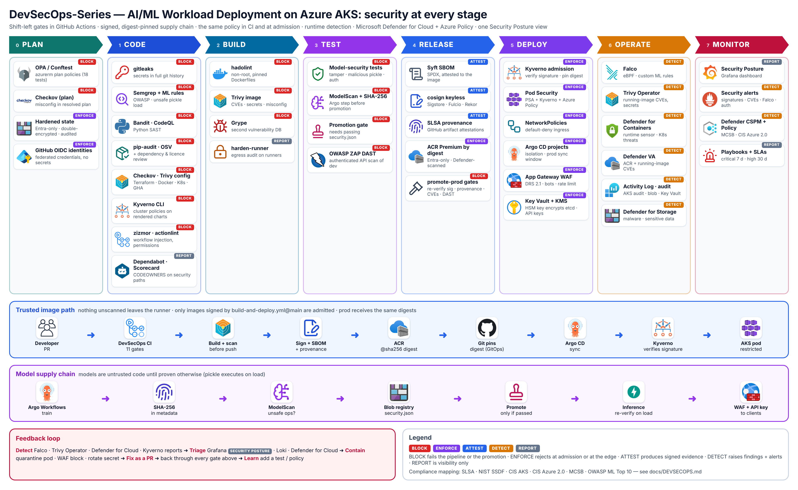
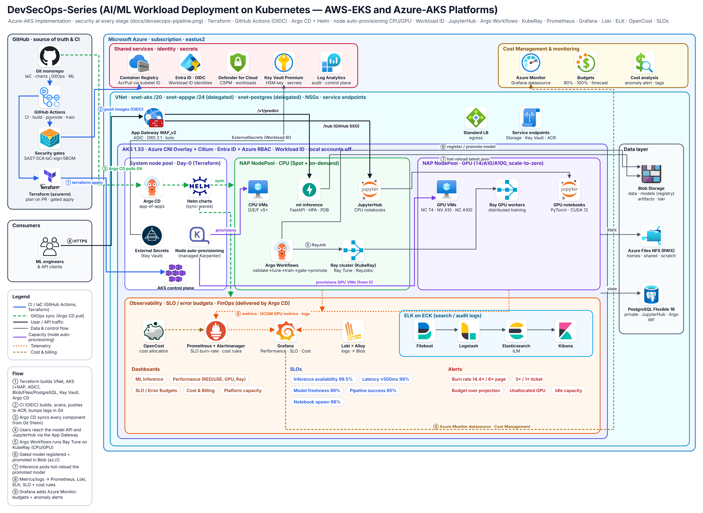

# DevSecOps-Series (AI/ML Workload Deployment on Kubernetes — Azure-AKS Platform)

**Terraform · Azure Kubernetes Service (AKS) · node auto-provisioning (CPU + GPU) · GitHub Actions (OIDC) · Argo CD + Helm · JupyterHub · Argo Workflows · Ray/KubeRay · Prometheus · Grafana · Loki · ELK · OpenCost · SLO error budgets**
**+ Security at every stage:** gitleaks · Semgrep · Bandit · CodeQL · pip-audit · OSV · Checkov · Trivy · Grype · Conftest/OPA · Kyverno · zizmor · hadolint · Syft SBOM · cosign (Sigstore) · SLSA provenance · ModelScan · OWASP ZAP · Falco · Trivy Operator · Application Gateway WAF · AKS KMS (HSM key) · Microsoft Defender for Cloud · Azure Policy · Log Analytics audit

> This repository implements the **Azure-AKS** platform, **DevSecOps edition**. Related repositories in the series:
> [DevOps edition on Azure-AKS](https://github.com/Cloud-Deployment-Resources-asimshahibm/DevOps-Series-AI-ML-Workload-deployment-on-Azure-AKS) (same platform without the security layer) ·
> [DevSecOps edition on AWS-EKS](https://github.com/Cloud-Deployment-Resources-asimshahibm/DevSecOps-Series-AI-ML-Workload-deployment-on-AWS-EKS) ·
> [DevOps edition on AWS-EKS](https://github.com/Cloud-Deployment-Resources-asimshahibm/DevOps-Series-AI-ML-Workload-deployment-on-AWS-EKS).

## Description

This project contains an **end-to-end AI/ML workload deployment on an Azure Kubernetes Service (AKS) containerized environment**. It uses **Kubernetes and Helm charts** for packaging and running the workloads, **GitHub Actions** for CI/CD, and **Argo CD** for GitOps continuous delivery. It also has **full observability coverage with Prometheus and Grafana**: metrics, alerting, performance dashboards, SLO/SLI error budgets and cost/billing dashboards. Loki and the ELK stack add centralized logging.

It covers the whole ML lifecycle:

- **Develop** in multi-user JupyterHub notebooks (CPU and GPU profiles).
- **Train and tune** with Argo Workflows pipelines and distributed Ray Tune on KubeRay.
- **Gate and promote** models through a model registry on Azure Blob Storage.
- **Serve** them through a FastAPI inference service behind Azure Application Gateway (AGIC).

AKS node auto-provisioning (managed Karpenter) creates CPU and GPU VMs just in time. **Terraform** declares all infrastructure, Git drives every change, and nothing uses a stored key: GitHub Actions authenticate with OIDC federated credentials, pods with Microsoft Entra Workload ID, and humans with Entra ID.

This **DevSecOps** edition adds a **blocking security gate at every stage**: plan, code, build, test, release, deploy, operate and monitor. Only scanned, **signed** and digest-pinned images built by this repository's pipeline are admitted to the cluster. Model artifacts are **hashed and scanned for malicious pickle code** before they are promoted, and verified again before they are served. Kubernetes Secrets are encrypted with an HSM-backed Key Vault key, the public edge runs behind an **Application Gateway WAF**, and runtime threats are detected by Falco, Trivy Operator and **Microsoft Defender for Cloud**. Everything is visible on a Grafana *Security Posture* dashboard and in Defender's secure score, with alerts that link to playbooks.

## Security at every stage



| Stage | Gate (blocking unless noted) | Where |
|---|---|---|
| **Plan** | OPA/Conftest (18 tested azurerm rules: no shared keys, private PostgreSQL, KMS + Defender + Entra-only AKS, IP-restricted prod API, WAF_v2, no Owner grants) + Checkov on the Terraform **plan** | `terraform.yml`, `policy/terraform` |
| **Code** | gitleaks (full history) · Semgrep (+ custom ML rules) · Bandit · CodeQL · pip-audit · OSV · dependency review + licence policy · Checkov · Trivy config · Kyverno CLI on rendered charts · zizmor + actionlint | `ci.yml`, `codeql.yml` |
| **Build** | hadolint · image built locally → **Trivy + Grype must pass before push** · hardened runners | `build-and-deploy.yml` |
| **Test** | unit + model-security tests · **ModelScan** + SHA-256 in the training pipeline · promotion requires a passing scan · OWASP **ZAP** DAST on dev (through the WAF) | `ml/`, `charts/ml-pipelines`, `dast.yml` |
| **Release** | Syft **SBOM** · **cosign keyless signature** · SBOM attestation · **SLSA provenance** (stored in ACR Premium) · verified before CD · prod promotion re-verifies signature, provenance, fresh CVE scan, DAST | `build-and-deploy.yml`, `promote-prod.yml` |
| **Deploy** | **Kyverno**: verified signature + digest, ACR-only, no `latest`, restricted pod security, limits, no host access · PSA labels · Azure Policy (PSS, audit) · Cilium NetworkPolicies · Argo CD project isolation + prod sync window · **App Gateway WAF_v2** · AKS **KMS** (HSM key) · encryption at host · API keys | `charts/security-policies`, `argocd/`, `terraform/` |
| **Operate** | Falco (custom ML rules) · Trivy Operator · model integrity re-check at load · **Defender for Containers** (runtime sensor, image VA) · **Defender for Storage** (malware, sensitive data) · Defender for Key Vault / PostgreSQL / ARM · **Defender CSPM** + CIS Azure 2.0 · Activity Log, kube-audit, blob, Key Vault, WAF logs → Log Analytics | `platform/`, `terraform/modules/security-baseline` |
| **Monitor** | Grafana *Security Posture* dashboard · security alerts → playbooks · Defender secure score + alerts · authorized-traffic SLO · remediation SLAs | `observability/extras`, `charts/observability-rules` |

Full detail, the ML threat model, compliance mapping (SLSA, NIST SSDF, CIS AKS, CIS Azure, MCSB, OWASP ML) and incident playbooks: **[docs/DEVSECOPS.md](docs/DEVSECOPS.md)**.

## Architecture

**Pictorial view (Azure / tool icons)**



## Documentation

| Document | What's in it |
|---|---|
| [docs/DEVSECOPS.md](docs/DEVSECOPS.md) | **Security at every stage**: gates per stage, ML threat model, compliance mapping, exceptions + accepted risks, security playbooks |
| [docs/PLAN.md](docs/PLAN.md) | High-level plan: goals, component choices, **AWS → Azure mapping**, environments, security & observability model, milestones, cost, risks |
| [docs/RUNBOOK.md](docs/RUNBOOK.md) | **Step-by-step deployment runbook** (Phase 0 → 13, incl. security setup 3A and security validation 9A) + alert playbooks |
| [docs/OBSERVABILITY.md](docs/OBSERVABILITY.md) | Dashboards, **SLOs/SLIs + error-budget policy**, burn-rate alerting, **cost & billing** model |
| [docs/TROUBLESHOOTING.md](docs/TROUBLESHOOTING.md) | Symptom → cause → fix tables |
| [docs/devsecops-pipeline.png](docs/devsecops-pipeline.png) | Pictorial DevSecOps pipeline: security tools per stage. Source: [docs/diagrams/devsecops_pipeline.py](docs/diagrams/devsecops_pipeline.py) |
| [docs/architecture-pictorial.png](docs/architecture-pictorial.png) | Pictorial diagram with Azure / Kubernetes / tool icons. Source: [docs/diagrams/architecture_pictorial.py](docs/diagrams/architecture_pictorial.py) |

## What gets deployed

| Layer | Components |
|---|---|
| **Azure foundation** (Terraform) | Resource group · VNet (AKS /20, delegated Application Gateway and PostgreSQL subnets, private-endpoint subnet, NSGs, service endpoints) · **AKS 1.33** (system pool, **node auto-provisioning**, Azure CNI Overlay + Cilium, Entra ID + Azure RBAC, local accounts disabled, OIDC issuer + **Workload ID**, AGIC add-on, Azure Disk/Files CSI) · **Application Gateway v2** · **Blob Storage** (data, models, artifacts, loki; shared keys disabled) · **PostgreSQL Flexible Server 16** (private access) · **Key Vault** (RBAC) · Log Analytics (control-plane + Key Vault audit) · a managed identity per workload · ACR · GitHub OIDC identities |
| **Day-0 platform** (Terraform → Helm) | `azurefile-nfs` RWX StorageClass · Postgres ExternalName alias · Argo CD + root app-of-apps (carrying the Azure facts) |
| **GitOps platform** (Argo CD) | NAP NodePools + AKSNodeClasses (CPU Spot/on-demand, NVIDIA GPU) · External Secrets (Key Vault) · NVIDIA GPU Operator · KubeRay operator · Argo Workflows · JupyterHub · kube-prometheus-stack · Loki + Alloy · ECK operator + Elasticsearch/Logstash/Kibana/Filebeat |
| **Observability+** (Argo CD) | OpenCost (cost allocation) · `observability-rules` (SLO/SLI error budgets with multi-window burn-rate alerts, cost recording rules + budget/idle/GPU alerts) · Grafana dashboards: Cost & Billing, Performance, SLO / Error Budget, Inference, Platform · Azure Monitor datasource (Workload ID) · NodePool/NodeClaim metrics via kube-state-metrics |
| **Billing guardrails** (Terraform) | Cost Management budgets per environment (total + compute, 80 %/100 %/forecast) · subscription cost anomaly alert · `Project`/`Environment` tags on every resource (incl. NAP VMs and file shares) |
| **ML workloads** (Argo CD) | `ray-cluster` (autoscaling CPU+GPU workers) · `ml-pipelines` (validate → Ray Tune → train → gate → promote, nightly CronWorkflow) · `ml-inference` (FastAPI, HPA, AGIC ingress, SLO alerts) |
| **Security platform** (Argo CD) | Kyverno + `security-policies` (signature verification via Workload ID → ACR, pod security, registries, NetworkPolicies) · Policy Reporter · Falco + Falcosidekick · Trivy Operator · Grafana *Security Posture* dashboard + security alerts |
| **Azure security** (Terraform) | Defender for Cloud (Containers, Storage + malware scanning + sensitive data, Key Vault, OSS databases, ARM, CSPM) · Azure Policy (CIS Azure 2.0 audit; PSS restricted on the cluster) · Activity Log → security Log Analytics · Application Gateway **WAF_v2** policy · AKS **KMS** with an HSM key in Key Vault Premium · encryption at host · ACR Premium · diagnostic audit logs (AKS, Key Vault, blob, PostgreSQL, WAF) |
| **CI/CD** (GitHub Actions) | DevSecOps CI (11 gates) · CodeQL · Scorecard · Terraform plan + OPA/Checkov gates + gated apply · build → scan → push → SBOM → sign → attest → verify → digest-pinned GitOps bump · ZAP DAST · verified promote-to-prod PR · run training pipeline |

## Repository layout

```
.
├── terraform/
│   ├── global/                 # once per subscription: state storage, ACR, GitHub OIDC identities, anomaly alert
│   ├── stack/                  # one environment: VNet, Key Vault, AKS (+NAP, Workload ID, AGIC), App Gateway,
│   │                           #   Blob, PostgreSQL, workload identities, budgets, Day-0 platform
│   ├── envs/{dev,prod}/        # terraform.tfvars + backend.hcl per environment
│   └── modules/
│       ├── network/  app-gateway/  github-oidc/
│       ├── waf/                # Application Gateway WAF policy (DRS 2.1, bots, rate limit)
│       ├── security-baseline/  # Defender for Cloud plans, CIS policy, activity log (global)
│       ├── storage/            # Blob account + containers + lifecycle rules
│       ├── database/           # PostgreSQL Flexible Server + Key Vault secrets
│       ├── workload-identity/  # managed identities + federated credentials + data-plane roles
│       ├── cost-guardrails/    # Cost Management budgets per environment
│       └── platform/           # storage class, Postgres alias, Argo CD, root app (+ `cloud` facts)
├── argocd/app-of-apps/         # Helm chart rendering one Argo CD Application per component (sync-waves, cloudValues)
├── platform/                   # values for third-party charts: jupyterhub, argo-workflows, gpu-operator, kuberay, ESO, ECK,
│                               #   kyverno, policy-reporter, falco, trivy-operator
├── policy/terraform/           # OPA/Rego policies (+ unit tests) evaluated on every Terraform plan
├── observability/
│   ├── kube-prometheus-stack/  loki/  alloy/  opencost/
│   └── extras/                 # Grafana dashboards (cost, performance, SLO, ...), ServiceMonitors, platform alerts
├── charts/                     # our Helm charts
│   ├── ml-inference/           # FastAPI model server (AGIC ingress, Workload ID)
│   ├── ml-pipelines/           # Argo WorkflowTemplate + CronWorkflow + RBAC
│   ├── ray-cluster/            # RayCluster (CPU + GPU groups) + Azure Files scratch
│   ├── karpenter-nodepools/    # AKSNodeClasses + NodePools (node auto-provisioning)
│   ├── observability-rules/    # SLO/SLI error-budget engine + cost recording rules & alerts (per-env values)
│   ├── security-policies/      # Kyverno ClusterPolicies + NetworkPolicies (+ kyverno CLI tests)
│   ├── platform-config/        # namespaces (Pod Security Admission labels), ExternalSecrets (Key Vault), Postgres db-init Job, Jupyter SA/PVC
│   └── elastic-stack/          # ECK: Elasticsearch, Kibana, Logstash, Filebeat, ILM
├── ml/
│   ├── common/mlstore.py       # model registry on Blob (az://account/container) or a local directory
│   ├── training/               # validate_data, ray_tune, train (quality gate), scan_model (ModelScan), promote/rollback + Dockerfiles
│   ├── inference/              # FastAPI app: API-key auth, integrity-verified model load, Prometheus metrics, hot reload
│   └── tests/                  # pytest (runs locally, no Azure needed; Blob backend tested with a fake)
├── .github/                    # workflows (ci, codeql, scorecard, terraform, build-and-deploy, dast, promote-prod,
│                               #   run-training-pipeline), dependabot.yml, CODEOWNERS
├── .semgrep/ .zap/             # custom ML Semgrep rules, ZAP rule config
├── .checkov.yaml trivy.yaml .trivyignore .gitleaks.toml .hadolint.yaml zizmor.yml   # scanner configs + documented exceptions
├── scripts/                    # configure, bootstrap-global, deploy-env, render-chart, policy-check, wait-for-apps, access,
│                               #   smoke-test, teardown
├── docs/                       # DEVSECOPS, PLAN, RUNBOOK, OBSERVABILITY, TROUBLESHOOTING, diagrams
├── SECURITY.md                 # vulnerability reporting + remediation SLAs
└── Makefile
```

## Quick start (dev)

> Full detail, expected output and fixes for every step: **[docs/RUNBOOK.md](docs/RUNBOOK.md)**.

```bash
# 0. prerequisites: terraform>=1.10, az >=2.67, kubelogin, kubectl, helm, jq, yq, gh, argo; Owner on the subscription
az login && az account set --subscription "<subscription>"
az feature register --namespace Microsoft.Compute --name EncryptionAtHost   # encryption at host (once per subscription)

# 1. render subscription id, your Entra object id and the state account name into the repo, push
make configure && git commit -am "chore: configure subscription" && git push

# 2. global layer: state storage, ACR, GitHub OIDC identities
make global
#    -> set the printed values as GitHub repo variables, create Environments dev/prod

# 3. build images before the cluster exists (bumps tags in values-dev.yaml)
gh workflow run build-and-deploy.yml && gh run watch && git pull

# 4. provision dev (VNet, AKS + NAP + KMS + Defender, App Gateway WAF, Blob, PostgreSQL, Key Vault, ... + Argo CD)
make deploy ENV=dev
GW=$(terraform -chdir=terraform/stack output -raw app_gateway_fqdn)
gh variable set DEV_INFERENCE_URL --body "http://$GW"
gh secret set DAST_API_KEY --body "$(az keyvault secret show --vault-name "$(terraform -chdir=terraform/stack output -raw key_vault_name)" -n inference-api-keys --query value -o tsv | jq -r .keys)"

# 5. JupyterHub GitHub OAuth secret (see runbook Phase 6)
az keyvault secret set --vault-name "$(terraform -chdir=terraform/stack output -raw key_vault_name)" \
  --name jupyterhub-github-oauth --value '{"client_id":"...","client_secret":"..."}'

# 6. train -> tune on Ray -> gate -> promote; inference hot-loads the model
gh workflow run run-training-pipeline.yml -f environment=dev

# 7. verify + open UIs
make smoke ENV=dev   # includes security checks: unsigned image rejected, 401 without API key, WAF blocks XSS, Kyverno/Falco/Trivy/Defender up
make access     # Argo CD :8080 · Grafana :3000 · Argo WF :2746 · JupyterHub :8000 · Ray :8265 · Kibana :5601 · OpenCost :9091
                # Grafana folders: FinOps › Cost & Billing · ML Platform › Performance · SRE › SLO / Error Budgets · Security › Security Posture
```

Call the model:

```bash
GW=$(kubectl -n ml-serving get ingress ml-inference -o jsonpath='{.status.loadBalancer.ingress[0].ip}')
API_KEY=$(kubectl -n ml-serving get secret ml-inference-api-keys -o jsonpath='{.data.api-keys}' | base64 -d | head -1)
curl -s http://$GW/v1/predict -H 'content-type: application/json' -H "x-api-key: $API_KEY" -d '{"instances": [[5.1,3.5,1.4,0.2]]}'
# {"model":"iris-classifier","model_version":"20261114...","predictions":[{"label":"setosa",...}]}
```

## Local development (no Azure)

```bash
cd ml
python -m venv .venv && source .venv/bin/activate
pip install -r requirements-dev.txt
pytest -q                                    # 26 tests: data/training gates, promote/rollback, API, Blob registry,
                                             # model security (tamper, malicious pickle via ModelScan, auth, headers)

# train -> scan -> promote -> serve locally against a directory-backed registry
export PYTHONPATH=common:training:inference
python -m trainer.train --model-store ./artifacts/models --version-file /tmp/v && V=$(cat /tmp/v)
python -m trainer.scan_model --model-store ./artifacts/models --version "$V"   # ModelScan + SHA-256 -> security.json
python -m trainer.promote    --model-store ./artifacts/models --version "$V"   # refuses unscanned / tampered models
export API_KEY=$(openssl rand -hex 16)          # any value; auth is on by default
MODEL_STORE_URI=./artifacts/models API_KEYS="$API_KEY" uvicorn app.main:app --port 8080
```

## Key design decisions

- **Terraform installs only what GitOps needs to start** (storage class, Argo CD + one root Application). AKS itself provides metrics-server, CSI drivers, node auto-provisioning, the Workload ID webhook and AGIC. Everything else is in Git and reconciled by Argo CD → drift is self-healed, every change is a PR.
- **Azure facts flow from Terraform into GitOps, never copied by hand**: client ids, storage account, Key Vault URI and ACR login server go to the root Application as `cloud:` values and are templated into each child app (`cloudValues`). `scripts/render-chart.sh` reproduces exactly what Argo CD renders, so CI validates the same thing.
- **Node auto-provisioning instead of node pools for workloads** — just-in-time VMs, Spot in dev, GPU **scale-to-zero**, consolidation, no Karpenter controller to run or upgrade; the GPU NodePool only reclaims *empty* nodes so long jobs are never evicted.
- **No keys anywhere**: GitHub → Azure via OIDC federated credentials, pods → Azure via Workload ID, humans → AKS via Entra ID; ACR admin user, AKS local accounts and storage shared keys are all disabled.
- **Model registry = Blob + pointer file.** Promotion/rollback is an atomic `latest.json` write; inference replicas hot-reload → model changes need no deployment. Images and models are versioned independently; the inference identity can only read the `models` container.
- **Build once, promote everywhere — by digest**: the same signed `sha256` digest flows dev → prod through a reviewed PR, and is re-verified (signature, provenance, fresh CVE scan, DAST) before the PR is opened.
- **Same policy in CI and cluster**: the Kyverno policies that guard admission also run in CI against the charts rendered exactly as Argo CD renders them, so a PR can't merge what the cluster would reject.
- **Models are treated as untrusted code** until proven otherwise: hashed, ModelScan-ed, promoted only with a passing `security.json`, and re-verified on every load.
- **Azure-native defence in depth**: WAF at the edge, Entra ID everywhere, KMS for etcd, Defender for runtime/data/posture, Azure Policy for compliance reporting, Log Analytics for the audit trail.
- **Fail closed, document exceptions**: every scanner blocks; every suppression is a reviewed line with a reason (`.checkov.yaml`, `.trivyignore`), and the remaining accepted risks are listed with their fix in DEVSECOPS.md.
- **Secrets never touch Git**: Terraform writes them to Key Vault; External Secrets syncs them; PostgreSQL app roles/databases are created by an idempotent hook Job.
- **SLOs as code**: each SLO is two PromQL expressions in `charts/observability-rules/values.yaml`; the chart generates the multi-window burn-rate rules, error-budget series and alerts, and the SLO dashboard discovers new SLOs automatically.
- **Cost from three angles**: OpenCost for real-time allocation (namespace, NodePool, GPU, idle), Cost Management for the real bill, and budgets + anomaly alerts for guardrails. All are tied together by consistent `Project`/`Environment` tags.
- **Two log pipelines on purpose**: Loki (cheap, all namespaces, correlated with metrics in Grafana) and ELK (full-text search, longer retention for ML/platform namespaces). Disable either in `argocd/app-of-apps/values.yaml`.

## Cost

dev idle baseline ≈ **$900–1,100/month** (DevOps baseline + WAF_v2 gateway, Key Vault Premium, ACR Premium and Defender plans) — see PLAN.md for the breakdown. GPUs cost only while in use (`Standard_NC4as_T4_v3` ≈ $0.53/h). Run `make destroy ENV=dev` when you are done. Details in [PLAN.md §7](docs/PLAN.md#7-cost-guide-eastus2-pay-as-you-go-list-prices-rounded--check-the-azure-pricing-calculator).

## Versions

| Component | Version |
|---|---|
| Terraform / azurerm provider | ≥ 1.10 / ~> 5.13 |
| AKS / node auto-provisioning | 1.33 / managed (Karpenter `karpenter.sh/v1`, `karpenter.azure.com/v1beta1`) |
| Argo CD chart / Argo Workflows chart | 7.7.10 / 0.45.1 |
| JupyterHub (z2jh) / KubeRay / Ray | 4.0.0 / 1.2.2 / 2.40.0 |
| kube-prometheus-stack / Loki / Alloy | 66.2.1 / 6.24.0 / 0.10.1 |
| ECK / Elastic stack | 2.16.0 / 8.17.0 |
| NVIDIA GPU operator / External Secrets | v24.9.1 / 0.12.1 |
| OpenCost chart | 2.5.33 |
| Azure SDK (ML code) | azure-identity 1.27.0 / azure-storage-blob 12.31.1 |
| Kyverno chart / Policy Reporter / Falco / Trivy Operator | 3.9.2 / 3.11.2 / 9.2.2 / 0.33.0 |
| Trivy / cosign / ModelScan / Checkov / zizmor | 0.76.1 / 2.4.1 / 0.8.8 / 3.2.334 / 1.31.1 |

All chart versions are pinned in `argocd/app-of-apps/values.yaml` and `terraform/modules/platform/variables.tf`; upgrade them through PRs (dev first).

---

Part of the **DevOps / DevSecOps Series** by Asim Khan. Found a vulnerability? See [SECURITY.md](SECURITY.md).
