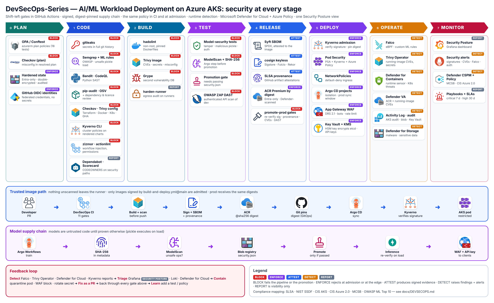

# DevSecOps — security at every stage of the pipeline (Azure AKS)

This is the **DevSecOps edition** of the Azure AKS AI/ML platform: the same platform as the
DevOps edition, plus a security control (a gate, a check or a guardrail) at each stage,
from the developer's commit to the running pod:

```
 PLAN ──► CODE ──► BUILD ──► TEST ──► RELEASE ──► DEPLOY ──► OPERATE ──► MONITOR
 OPA on   secrets  hadolint  unit +   SBOM        Kyverno    Falco       Security
 TF plan  SAST     Trivy     model-   cosign      admission  Trivy-Op    Posture
 Checkov  SCA      Grype     sec      SLSA        PSA/Policy Defender    dashboard
 plan     IaC      (fail =   tests    provenance  NetPol     for Cloud   + alerts
          GHA lint  no push) DAST     verify      WAF · KMS  audit logs  → playbooks
```



Principles:

1. **Fail early, fail closed.** Every stage has a *blocking* gate. A finding fails the job.
   It is not just reported.
2. **Same policy in CI and in the cluster.** The Kyverno policies that admit pods in AKS
   also run in CI against the charts rendered exactly as Argo CD renders them
   (`scripts/render-chart.sh` + `scripts/policy-check.sh`). A PR cannot merge something
   the cluster would reject.
3. **Trust digests, not tags.** Only signed images, pinned by `sha256` digest, built by
   `build-and-deploy.yml` on `main`, run in ML namespaces. Prod gets the *same digests*
   that passed dev.
4. **Models are code.** A model artifact is hashed, scanned for unsafe pickle operators and
   verified again before it is loaded.
5. **No keys anywhere.** GitHub → Azure via OIDC federated credentials, pods → Azure via
   Workload ID, humans → AKS via Entra ID. ACR admin user, AKS local accounts and storage
   shared keys are disabled.
6. **Exceptions are explicit.** Every suppression lives in a reviewed file with a reason
   (`.checkov.yaml`, `.trivyignore`, `zizmor.yml`).

---

## 1. Stage-by-stage controls

**Block** = fails the pipeline or rejects the request. **Warn** = reported (SARIF in the
GitHub Security tab, PolicyReport, alert) without blocking.

### Stage 0 — PLAN (Terraform)

| Control | Tool | Where | Mode |
|---|---|---|---|
| Plan-time policy (18 unit-tested rules): storage shared keys off / private containers / TLS 1.2, PostgreSQL private, Key Vault RBAC + purge protection (prod) + key rotation, ACR admin off, AKS local accounts off + Azure RBAC + Workload ID + KMS + Defender, **prod API server IP-restricted**, NSG Internet ingress only 80/443, gateway must be WAF_v2 with a policy (Prevention in prod), no `Owner` assignments, no wildcard custom roles | Conftest / OPA (`policy/terraform/*.rego`) | `terraform.yml` on the plan JSON | Block |
| Plan-time misconfiguration scan | Checkov `--framework terraform_plan` | `terraform.yml` | Block |
| Least-privilege CI identities (plan = Reader + custom read-only cluster role; apply = Environment-gated) | GitHub OIDC → managed identities | `terraform/modules/github-oidc` | Enforced |
| State: Entra-only (shared keys off), double encryption, versioning + soft delete, access audit-logged | Terraform | `terraform/global` | Enforced |

### Stage 1 — CODE (every PR and push, `ci.yml`)

| Control | Tool | Mode |
|---|---|---|
| Secrets in the code and the **full git history** | gitleaks (`.gitleaks.toml`) | Block |
| SAST: OWASP Top 10, Python, Dockerfile, K8s, Terraform and Actions rulesets, plus **custom ML rules** (`.semgrep/ml-security.yml`): unverified `pickle`/`joblib`/`torch.load`, `yaml.load`, `requests` without timeout, `shell=True` | Semgrep | Block (ERROR) |
| Python security linter | Bandit (`ml/bandit.yaml`) | Block (medium+) |
| Semantic code analysis | CodeQL (`codeql.yml`, weekly + PR) | Block via branch-protection code-scanning rule |
| Vulnerable dependencies | pip-audit (`--strict`) + OSV-Scanner | Block |
| New dependencies in a PR: vulnerabilities ≥ high, copyleft licences (AGPL/SSPL) | dependency-review-action | Block |
| IaC: Terraform (azurerm), Dockerfiles, GitHub Actions, **rendered** Helm charts | Checkov (`.checkov.yaml`) + Trivy config (`trivy.yaml`) | Block (HIGH/CRITICAL) |
| Kubernetes admission policies applied to rendered charts (shift-left) | Kyverno CLI `test` (14 cases) + `apply` | Block |
| Workflow security: template injection, excessive `permissions`, `pull_request_target`/`workflow_run` misuse, credential persistence | zizmor (`zizmor.yml`) + actionlint | Block |
| Repo hygiene | OpenSSF Scorecard (`scorecard.yml`), Dependabot (pip, Docker, Actions, Terraform), CODEOWNERS on security paths | Warn / review |

### Stage 2 — BUILD (`build-and-deploy.yml`)

| Control | Tool | Mode |
|---|---|---|
| Dockerfile best practice (pinned versions, non-root `USER`, no `ADD` from URLs) | hadolint (`.hadolint.yaml`) | Block |
| Hardened runners (egress audit, tamper detection) | step-security/harden-runner | Audit → move to `block` with an allow-list once baselined |
| Minimal, non-root images: `python:3.12-slim-bookworm`, `USER 1000`, read-only root filesystem at runtime | Dockerfiles + chart `securityContext` | Enforced |
| **Images are built locally and scanned *before* they are pushed.** Nothing unscanned reaches ACR | `docker/build-push-action` with `load: true` | — |
| Vulnerabilities + embedded secrets + misconfiguration in the image | Trivy image (fixable HIGH/CRITICAL) | Block |
| Second opinion from a different vulnerability database | Grype (fixable CRITICAL) | Block |

### Stage 3 — TEST

| Control | Tool | Mode |
|---|---|---|
| Unit tests incl. **model-security tests**: tampered artifact rejected, malicious pickle detected by the real ModelScan, API key enforced, security headers present | pytest (`ml/tests/test_security.py`) | Block |
| Model scan inside the training pipeline: SHA-256 check, then ModelScan for unsafe pickle operators. Writes `security.json` next to the model in Blob | `scan_model.py` (Argo step `model-security-scan`) | Block (exit 4/5/6) |
| Promotion refuses a model without a passing `security.json` whose digest matches | `promote.py --require-scan` | Block |
| **DAST**: OWASP ZAP API scan of the deployed dev inference API (authenticated with `DAST_API_KEY`, through the WAF) | `dast.yml` (after every deploy + nightly) | Block on FAIL rules (`.zap/rules.tsv`), report uploaded as an artifact |

### Stage 4 — RELEASE (supply chain, SLSA Build L3-style)

| Control | Tool | Mode |
|---|---|---|
| SBOM (SPDX JSON) for every image | Syft (`anchore/sbom-action`) | Always |
| **Keyless signature** bound to `build-and-deploy.yml@refs/heads/main`, logged in Rekor, stored next to the image in ACR | cosign + Sigstore Fulcio | Always |
| SBOM attestation | `cosign attest --type spdxjson` | Always |
| SLSA build provenance, pushed to ACR | `actions/attest-build-provenance` | Always |
| Signature + attestation verified before CD gets the digest | `cosign verify` / `verify-attestation` | Block |
| Prod promotion (`promote-prod.yml`): verify signature + provenance for each digest, **fresh** Trivy scan, last DAST green, then a PR with CODEOWNERS review | cosign, `gh attestation verify`, Trivy | Block |
| Registry: ACR **Premium**, admin user disabled, Entra-only push/pull, zone-redundant, untagged manifests purged after 7 days, every push scanned by Defender | Terraform (`terraform/global`) | Enforced |

### Stage 5 — DEPLOY (Argo CD + admission control)

| Control | Tool | Where | Mode |
|---|---|---|---|
| **Image signature verification** at admission (keyless, our workflow identity) + digest mutation; signatures fetched from ACR with Workload ID (`image-verifier`, AcrPull) | Kyverno `verify-ml-image-signatures` | `charts/security-policies` | Enforce |
| Only our ACR (+ the Argo executor) in ML namespaces | Kyverno `restrict-image-registries` | ″ | Enforce |
| No `:latest` / tag-less images | Kyverno `disallow-latest-tag` | ″ | Enforce |
| Restricted pod security: non-root, no privilege escalation, drop ALL capabilities, RuntimeDefault seccomp | Kyverno `ml-restricted-pod-security` + Pod Security Admission labels (`restricted` on `ml-serving`) + **Azure Policy** PSS-restricted initiative (audit, compliance view) | ″ + `platform-config` + Terraform | Enforce / audit |
| CPU/memory requests + memory limit | Kyverno `ml-require-requests-limits` | ″ | Enforce (prod) / Audit (dev) |
| No hostPath / hostNetwork / hostPID outside system namespaces | Kyverno `disallow-host-access` | ″ | Enforce |
| Default-deny ingress + explicit allows (Prometheus scrape, Ray, **Application Gateway subnet → inference**) — Cilium enforces them | NetworkPolicy | `security-policies`, `ml-inference` | Enforce |
| Argo CD project isolation: ML apps (`ml-workloads` project) can only deploy to ML namespaces, cannot create cluster-scoped resources | AppProject | `argocd/app-of-apps` | Enforce |
| Prod change window (no syncs 22:00–06:00 UTC; manual sync allowed for hotfixes) | Argo CD `syncWindows` | `values-prod.yaml` | Enforce |
| Secrets come only from Key Vault (RBAC, Premium) via Workload ID. Nothing secret lives in Git | External Secrets | `charts/*/templates` | Enforce |
| **Kubernetes Secrets encrypted in etcd with an HSM-backed Key Vault key** (AKS KMS, rotated by policy) | Terraform | `terraform/stack` | Enforced |
| **Encryption at host** on system pool and NAP VMs (temp disks, caches, OS-disk data flows) | Terraform + `AKSNodeClass` | `terraform/stack`, `charts/karpenter-nodepools` | Enforced |
| Edge protection: **Application Gateway WAF_v2 policy** — Microsoft Default Rule Set 2.1 (OWASP CRS-based, incl. Log4Shell), Bot Manager 1.0, per-IP rate limit, body-size cap, `x-api-key` excluded from inspection/logs; firewall log to Log Analytics | `terraform/modules/waf` | Gateway-wide (all AGIC listeners) | Block (Prevention) |
| API authentication (constant-time compare), security headers, Swagger docs off in prod, no service-account token mounted | FastAPI app + chart | `ml/inference`, `charts/ml-inference` | Enforce |

### Stage 6 — OPERATE (runtime)

| Control | Tool | Mode |
|---|---|---|
| Syscall-level threat detection, with custom ML rules: *shell in model-serving container*, *cryptominer in ML namespace*, *SA token read by unexpected process*, *package manager in running container* | Falco (modern eBPF) → Falcosidekick → Alertmanager + Loki | Detect + alert |
| Continuous vulnerability, exposed-secret, config-audit and RBAC scanning of what is *running* (pulls from ACR with Workload ID) | Trivy Operator | Detect + alert |
| Policy results UI and metrics | Policy Reporter | Report |
| Model integrity re-checked at every load. A tampered artifact is refused and counted (`mlserve_model_integrity_failures_total`) | `ModelManager.verify()` | Block |
| **Defender for Containers**: runtime sensor (eBPF) threat detection, K8s audit-log analytics, ACR + running-image vulnerability assessment, agentless discovery | Defender for Cloud (`terraform/modules/security-baseline`) | Detect |
| **Defender for Storage**: activity anomalies, **on-upload malware scanning**, **sensitive-data discovery** in the ML data account | ″ | Detect |
| Defender for Key Vault, open-source databases (PostgreSQL), Resource Manager | ″ | Detect |
| **Defender CSPM**: secure score, attack paths, Microsoft Cloud Security Benchmark + **CIS Microsoft Azure Foundations 2.0** (Azure Policy, audit) | ″ | Detect |
| Audit trail: subscription **Activity Log**, AKS control-plane + **kube-audit**, Key Vault audit, **blob read/write/delete** (models, data, state), PostgreSQL logs, WAF logs → Log Analytics | diagnostic settings | Record |

### Stage 7 — MONITOR & RESPOND

* Grafana **Security Posture** dashboard (`observability/extras/dashboards/security-posture.json`,
  folder *Security*): admission denials, signature failures, policy failures by namespace,
  critical/high CVEs in running images, exposed secrets, Falco events by rule and priority,
  model-integrity and auth failures.
* Prometheus alerts in `charts/observability-rules/templates/security-rules.yaml`.
  Each one has a playbook [below](#playbooks).
* **Defender for Cloud** alerts (e-mail to `security_contact_email`; stream them to your SIEM,
  e.g. Microsoft Sentinel, with *continuous export*), **secure score** and **regulatory compliance**.
* The `ml-inference-authorized-traffic` SLO tracks the share of requests that pass
  authentication, so abuse eats into a visible error budget.
* Remediation SLAs (also in `SECURITY.md`): **critical 7 days**, **high 30 days**.

---

## 2. ML-specific threat model

| Threat | Example | Controls |
|---|---|---|
| **Malicious model artifact** (arbitrary code via pickle) | Attacker uploads a `model.pkl` whose `__reduce__` runs `os.system` | ModelScan in the pipeline · SHA-256 pinned in metadata · `promote.py --require-scan` · `ModelManager.verify()` before `load` · Blob: Entra-only, write access only for the training identity · Defender for Storage malware scanning · blob write audit logs · Semgrep rule `unverified-model-deserialization` |
| **Model / data tampering at rest** | Swap the artifact in Blob after promotion | Digest re-check at every load · blob versioning + soft delete · inference identity is read-only on `models` · `ModelArtifactIntegrityFailure` alert |
| **Poisoned dependency** | Typosquatted or compromised PyPI package | Pinned requirements · pip-audit + OSV · dependency review · Dependabot · Trivy/Grype in the image · Defender VA in ACR |
| **Compromised CI / image swap** | Push of an image built outside the pipeline | OIDC-only Azure access (no client secrets) · cosign keyless + Kyverno verifyImages · digest pinning · SLSA provenance verification before prod |
| **Workflow injection** | PR title with `$(curl …)` in a `run:` step | zizmor + actionlint · inputs passed through `env:` and validated · minimal `permissions:` per job · `persist-credentials: false` |
| **Inference API abuse** | Credential stuffing, scraping the model, oversized payloads | API keys in Key Vault · WAF rate limit + body cap + managed rules + bot protection · `InferenceAuthFailureSpike` · ZAP DAST |
| **Container escape / lateral movement** | RCE in the API spawns a shell, reads the SA token | Non-root, read-only root FS, drop ALL, seccomp · no SA token mounted · Cilium NetworkPolicies · Falco ML rules · Defender for Containers sensor |
| **GPU / compute hijacking** | Cryptominer on a GPU node | Falco cryptominer rule · Defender for Containers (crypto-mining detections) · NodePool limits · cost anomaly alerts (`CostHourlySpike`) |
| **Sensitive training data exposure** | PII in the data container, a public container | Defender for Storage sensitive-data discovery · private containers + shared keys off (OPA-enforced) · storage firewall (AKS subnet only) |
| **Secrets / etcd exposure** | etcd backup or snapshot leaks Kubernetes Secrets | AKS KMS with HSM-backed Key Vault key · secrets sourced from Key Vault, never Git |
| **Notebook as an entry point** | Secrets hard-coded in a JupyterHub notebook | GitHub OAuth for JupyterHub · per-user Workload ID scope · gitleaks on anything committed · WAF in front of the hub |

---

## 3. Compliance mapping (indicative)

| Framework | How this repo maps |
|---|---|
| **SLSA v1.0 Build track** | L2: hosted build + signed provenance (`attest-build-provenance`). Toward L3: isolated, ephemeral GitHub-hosted runners, provenance verified before prod (`promote-prod.yml`) |
| **NIST SSDF (SP 800-218)** | PO.3 (toolchain: pinned scanners) · PS.1–PS.3 (protect code, signed releases, SBOM) · PW.4/PW.7/PW.8 (dependency review, SAST, DAST) · RV.1–RV.3 (Trivy Operator, Defender VA, SLA alerts, SECURITY.md) |
| **CIS AKS Benchmark** | Entra ID + Azure RBAC, local accounts disabled · API server authorized IP ranges (OPA-enforced for prod) · secrets encryption with KMS · audit logs · PSA + Kyverno restricted profile · NetworkPolicies · Workload ID · Azure Policy add-on |
| **CIS Microsoft Azure Foundations 2.0** | Azure Policy initiative assigned (audit) → Defender for Cloud regulatory compliance · Activity Log retained in Log Analytics · Key Vault RBAC + purge protection (prod) · storage secure transfer + no public access |
| **Microsoft Cloud Security Benchmark** | Default Defender for Cloud standard; Defender CSPM secure score |
| **OWASP ML Security Top 10** | ML06 (AI supply chain) → ModelScan, signing, digests · ML10 (model poisoning) → integrity checks, data-container controls · ML05 (model theft) → auth, WAF, rate limits |
| **OWASP Top 10 for LLM Apps** (if you serve LLMs later) | LLM03 supply chain → same controls · LLM10 unbounded consumption → WAF rate limit, HPA max, cost alerts |

---

## 4. Running the gates locally

```bash
# secrets, SAST, deps
gitleaks dir . --config .gitleaks.toml --redact
semgrep scan --config p/owasp-top-ten --config .semgrep/ml-security.yml --error .
bandit -r ml -c ml/bandit.yaml -ll -ii
pip-audit -r ml/inference/requirements.txt -r ml/training/requirements.txt

# IaC + policies
mkdir -p rendered && for c in charts/*; do scripts/render-chart.sh template $c prod > rendered/$(basename $c).yaml; done
checkov --config-file .checkov.yaml
trivy config --config trivy.yaml .
conftest verify -p policy/terraform
scripts/policy-check.sh                      # Kyverno test + apply on rendered charts

# workflows + Dockerfiles
zizmor --config zizmor.yml .github/workflows && actionlint
hadolint --config .hadolint.yaml ml/*/Dockerfile*

# model security
cd ml && pytest -q tests/test_security.py
```

Verify a running image yourself:

```bash
ACR="$(gh variable get ACR_NAME).azurecr.io"; az acr login -n "${ACR%%.*}"
IMG="$ACR/aiml/ml-inference@$(yq '.image.digest' charts/ml-inference/values-dev.yaml)"
cosign verify "$IMG" \
  --certificate-identity "https://github.com/<org>/<repo>/.github/workflows/build-and-deploy.yml@refs/heads/main" \
  --certificate-oidc-issuer https://token.actions.githubusercontent.com
gh attestation verify "oci://$IMG" --repo <org>/<repo>
```

## 5. Exceptions process

1. Prefer a fix: upgrade the package, change the code, harden the resource.
2. If you can't fix it yet, add a **time-boxed** exception with a reason and an owner:
   * vulnerability or Trivy misconfig → `.trivyignore` (`<ID> exp:YYYY-MM-DD` with a reason comment)
   * IaC check → `.checkov.yaml` with a reason (every current skip is justified there)
   * Kyverno → a `PolicyException` in the `kyverno` namespace (reviewed by `@security` via CODEOWNERS)
3. Security-relevant paths (`.github/`, `policy/`, `charts/security-policies/`, scanner
   configs, `terraform/modules/security-baseline`, `terraform/modules/waf`) need a CODEOWNERS approval.

Accepted risks shipped with this repo (and how to remove them):

| Risk | Why | Remove it by |
|---|---|---|
| Key Vault + state storage reachable from the Internet (Entra ID + RBAC only, audited) | GitHub-hosted runners run Terraform; AKS KMS uses public key-vault mode | self-hosted runners in the VNet → `key_vault_default_action = "Deny"`, storage firewall; private endpoints in `snet-endpoints`; AKS API server VNet integration for private KMS |
| Dev API server open to any IP | quick start | `api_server_authorized_ip_ranges` (prod already blocked by OPA) |
| ACR public endpoint | GitHub-hosted runners push | self-hosted runners + `public_network_access_enabled = false` + private endpoint |
| Platform-managed keys for disks/storage (+ double encryption) | CMK adds key-loss blast radius for regenerable data | disk encryption set + storage CMK in Key Vault |

---

## Playbooks

### <a id="sec-image-signature"></a>KyvernoImageSignatureVerificationFailed (critical)
Something tried to run an image in an ML namespace that our workflow did not sign.
1. `kubectl get events -A --field-selector reason=PolicyViolation | grep verify-ml-image` shows the image and who applied it.
2. Was it a legitimate, unsigned build, e.g. a manual `docker push`? Revert it. Only `build-and-deploy.yml` may publish.
3. Otherwise treat it as a **supply-chain incident**. Check ACR push events (`ContainerRegistryRepositoryEvents` in Log Analytics if enabled, Activity Log for registry changes), rotate federated credentials if needed, and look for other pushes.

### <a id="sec-model-integrity"></a>ModelArtifactIntegrityFailure (critical)
The inference service refused a model whose SHA-256 does not match its metadata, or that has no passing scan (log: `model rejected by integrity check`).
1. The service keeps serving the previous verified model. Confirm with `/readyz` and the `model_version` in `/predict`.
2. Who wrote it: Log Analytics `StorageBlobLogs | where OperationName == "PutBlob" and Uri has "/models/"`; previous versions: `az storage blob list --include v ...`.
3. Restore the last good blob version, or re-run the pipeline. **Do not** turn off `REQUIRE_MODEL_SCAN`.

### <a id="sec-critical-cve"></a>CriticalVulnerabilityInRunningImage / SecretExposedInImage
1. `kubectl get vulnerabilityreports -n <ns> -o wide`, the Security Posture dashboard, or Defender for Cloud › Recommendations › *Container images ... vulnerability findings*.
2. Fix it in `ml/*/requirements.txt` or the base image. Merge, and `build-and-deploy.yml` ships a new signed digest. Promote it with `promote-prod.yml`.
3. For an exposed secret: **rotate it first** (Key Vault), then rebuild.

### <a id="sec-policy"></a>KyvernoPolicyViolations / KyvernoAdmissionDenials / CriticalMisconfigurationDetected
1. Policy Reporter UI: `kubectl -n kyverno port-forward svc/policy-reporter-ui 8082:8080`.
2. Fix the chart values. CI's `k8s-policy` job reproduces the result locally with `scripts/policy-check.sh`.

### <a id="sec-kyverno-down"></a>KyvernoWebhookDown (critical)
Admission control is degraded. Kyverno's webhooks fail closed for the ML namespaces, so deploys there will fail.
`kubectl -n kyverno get pods`, check the logs. Never delete the webhook configurations to "unblock" a deploy.

### <a id="sec-falco"></a>FalcoCriticalEvent / FalcoWarningEventsSpike / Defender for Containers alert
1. Grafana › Explore › Loki `{priority="Critical"} | json` (Falcosidekick labels) gives the pod, container, command and user; Defender for Cloud › Security alerts gives its own correlated view.
2. A shell or package manager in a serving pod, or a cryptominer: **isolate first**. Label the pod `quarantine=true` and apply a deny-all NetworkPolicy, or cordon the node. Keep the pod for forensics, then delete it.
3. Check kube-audit (`AKSAudit` in Log Analytics) for who exec'd into the pod.

### <a id="sec-auth"></a>InferenceAuthFailureSpike
1. WAF logs: `AGWFirewallLogs | summarize count() by ClientIp, RuleId | top 20 by count_` and `AGWAccessLogs` for the top client IPs.
2. Credential stuffing: add a WAF custom IP-block rule, or lower `waf.rate_limit_per_minute`.
3. A leaked key: rotate the `inference-api-keys` secret (Key Vault). External Secrets refreshes it within 15 min; restart the pods to pick it up at once.

### <a id="playbooks"></a>General incident flow
Detect (alert, Defender) → triage (dashboard, Loki, Log Analytics, Defender for Cloud) → contain (quarantine, WAF block, disable the federated credential / remove the role assignment) → eradicate (fix, rebuild, re-sign) → recover (promote verified digests) → post-mortem (add a test or policy so it can't recur).
